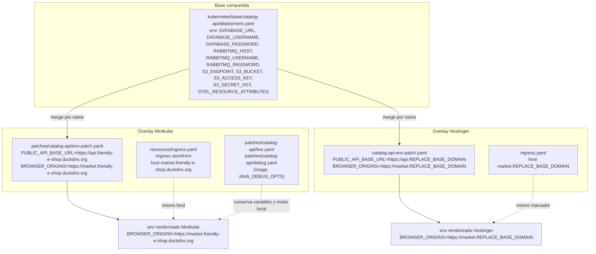
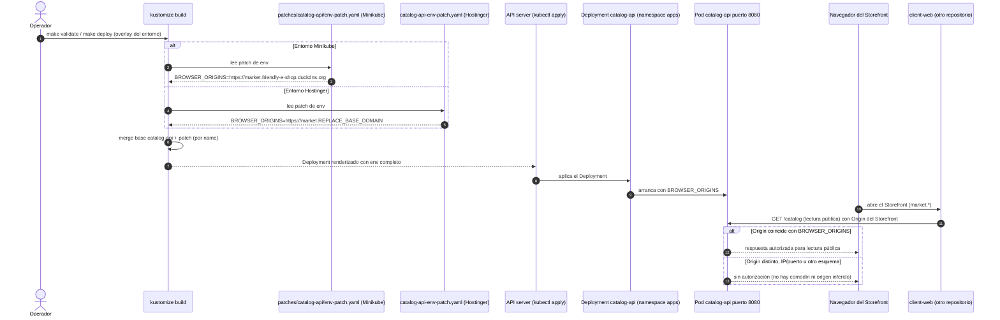
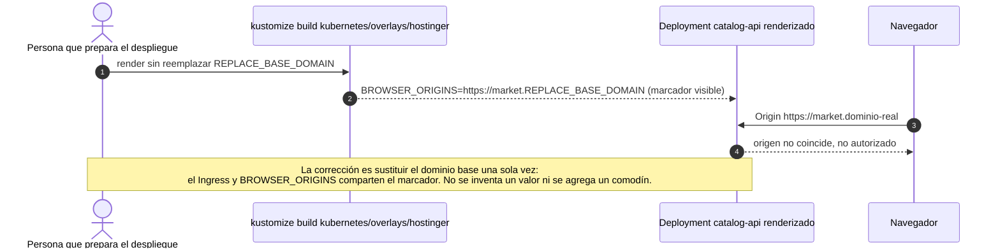

# UML 003 — Entregar el origen del Storefront a catalog-api

Diagramas del desarrollo descrito por `plan.md` y `tasks.md` en la rama
`003/feat-storefront-catalog-cors`. El corte solo agrega la variable de entorno `BROWSER_ORIGINS`
al contenedor `catalog-api` desde los patches de cada overlay; no cambia tipos, capas ni servicios
de aplicación, por lo que el UML se limita a la estructura de configuración y al flujo de consumo
desde el navegador.

Los diagramas muestran las relaciones operativas relevantes y omiten dependencias transitivas que
ya quedan explicadas por el recurso dueño (base, overlay o patch).

## Estructura: base + overlay → env de catalog-api

Nota: el merge estratégico de `env` se hace por la clave `name`; la entrada nueva no reemplaza las
diez variables de la base ni `PUBLIC_API_BASE_URL`. El panel no aparece: queda fuera de alcance.

## Flujo principal: render del origen y lectura pública desde el navegador

## Secuencia alternativa: Hostinger con el marcador sin sustituir

## Valores por entorno

| Entorno | Archivo del patch | `BROWSER_ORIGINS` | Secreto |
|---|---|---|---|
| Minikube | `kubernetes/overlays/minikube/patches/catalog-api/env-patch.yaml` | `https://market.friendly-e-shop.duckdns.org` | No |
| Hostinger | `kubernetes/overlays/hostinger/catalog-api-env-patch.yaml` | `https://market.REPLACE_BASE_DOMAIN` | No |

Ambos valores son orígenes completos: esquema `https`, sin ruta, sin barra final, sin comodines y
sin un segundo origen. `catalog-api` no recibe el origen del panel en este corte.
