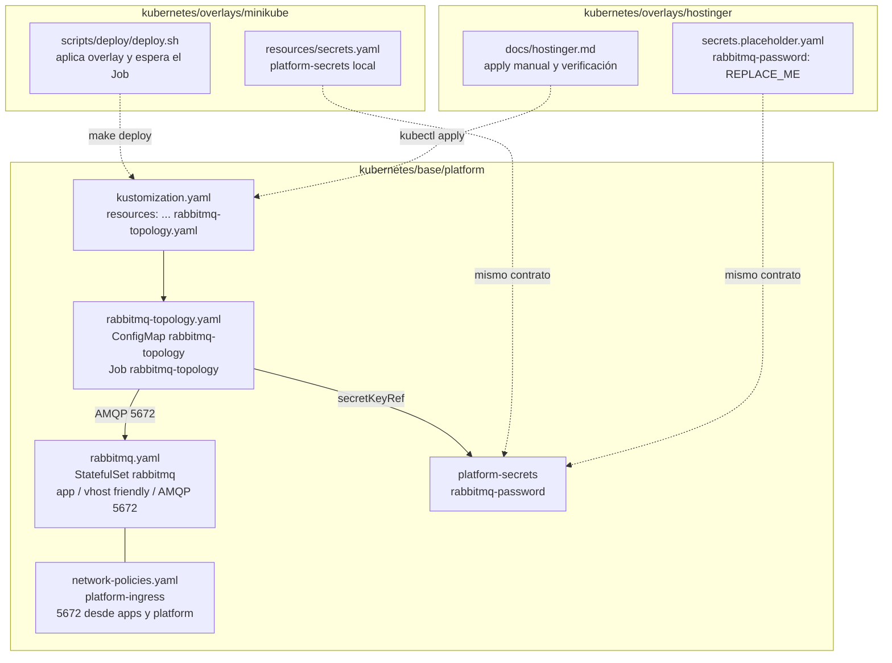
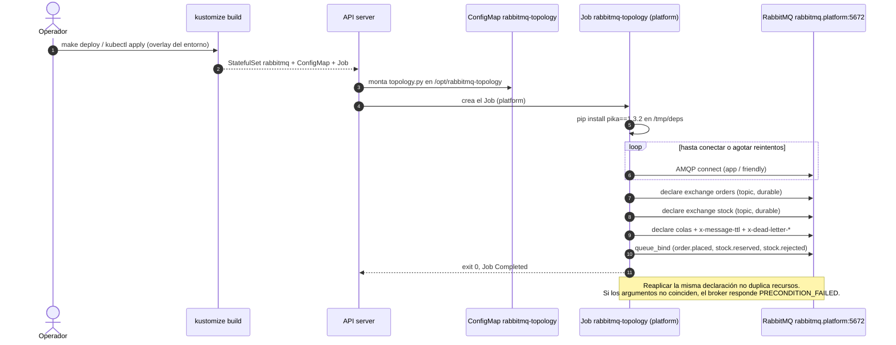
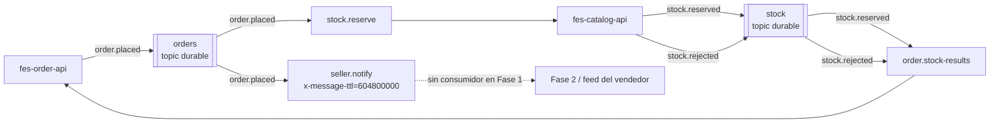
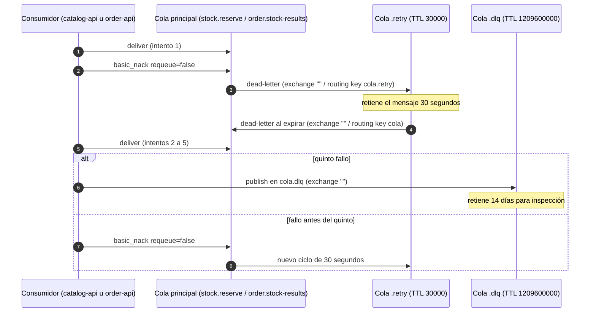

# UML 004 — Topología RabbitMQ para la venta asíncrona

Diagramas del desarrollo descrito por `plan.md` y `tasks.md` en la rama
`004/feat-rabbitmq-sale-topology`. El corte es de infraestructura: no agrega clases ni capas de
aplicación, sino un recurso de base que declara exchanges, colas, argumentos y enlaces en el
RabbitMQ existente. Los diagramas muestran la estructura de esa declaración y los flujos de
publicación, reintento y agotado.

Los nombres reales del contrato se conservan: exchange `orders` (topic, durable) con routing key
`order.placed`; colas `stock.reserve` y `seller.notify`; exchange `stock` (topic, durable) con
routing keys `stock.reserved` y `stock.rejected`; cola `order.stock-results`; usuario `app` y vhost
`friendly` en el puerto AMQP `5672`. No se agregan exchanges nuevos: los reintentos y las colas de
agotados usan el exchange por defecto (`""`).

## Estructura: base, overlays y recursos de topología



Nota: el `Job` vive en la base y hereda a ambos overlays; no se duplica la definición. La imagen
`python:3.12.7-alpine` instala `pika==1.3.2` en `/tmp/deps` y ejecuta el script del `ConfigMap`.
La NetworkPolicy no se modifica: la declaración usa `5672`, no el puerto de management `15672`.

## Flujo principal: despliegue y declaración idempotente



## Flujo de negocio: pedido, reserva y resultados



## Secuencia de reintento y agotado



El conteo de intentos es un contrato del consumidor: RabbitMQ acumula la traza en la cabecera
`x-death` y el consumidor decide el paso a la `.dlq` al quinto fallo. La topología no ejecuta
consumidores; solo declara la ruta de reintento, la demora y el destino de agotados.

## Secuencia de `seller.notify` sin consumidor

```mermaid
sequenceDiagram
  autonumber
  participant OA as fes-order-api
  participant OE as orders
  participant SN as seller.notify
  participant F2 as Consumidor Fase 2 (ausente)

  OA->>OE: publish order.placed
  OE->>SN: copia (routing key order.placed)
  Note over SN: x-message-ttl=604800000 (7 días)
  alt antes de 7 días
    Note over SN: el mensaje se retiene; no se descarta por falta de consumidor
  else al cumplir 7 días
    SN-->>SN: el mensaje caduca y se descarta
  end
  F2--xSN: consumo solo en Fase 2
```

## Recurso declarado

| Elemento | Tipo | Durable | Argumentos / enlace |
|---|---|---|---|
| `orders` | exchange topic | sí | routing key `order.placed` |
| `stock` | exchange topic | sí | routing keys `stock.reserved`, `stock.rejected` |
| `stock.reserve` | cola | sí | DLX `""` → `stock.reserve.retry`; bound a `orders`/`order.placed` |
| `seller.notify` | cola | sí | `x-message-ttl: 604800000`; bound a `orders`/`order.placed` |
| `order.stock-results` | cola | sí | DLX `""` → `order.stock-results.retry`; bound a `stock`/`stock.reserved` y `stock`/`stock.rejected` |
| `stock.reserve.retry` | cola | sí | `x-message-ttl: 30000`; DLX `""` → `stock.reserve` |
| `stock.reserve.dlq` | cola | sí | `x-message-ttl: 1209600000` |
| `order.stock-results.retry` | cola | sí | `x-message-ttl: 30000`; DLX `""` → `order.stock-results` |
| `order.stock-results.dlq` | cola | sí | `x-message-ttl: 1209600000` |

Variables reutilizadas por el `Job`: `RABBITMQ_HOST=rabbitmq.platform.svc.cluster.local`,
`RABBITMQ_USERNAME=app` y `RABBITMQ_PASSWORD` desde `platform-secrets`/`rabbitmq-password`. El
puerto `5672` y el vhost `friendly` quedan fijos en el script, igual que en la plataforma actual.
No se crean secretos, usuarios ni exchanges nuevos.
